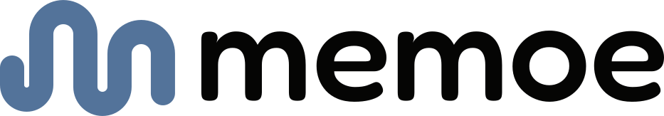
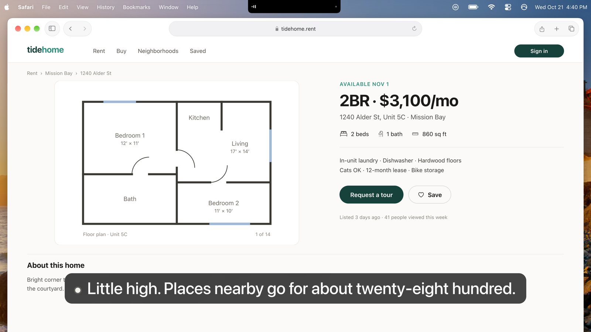
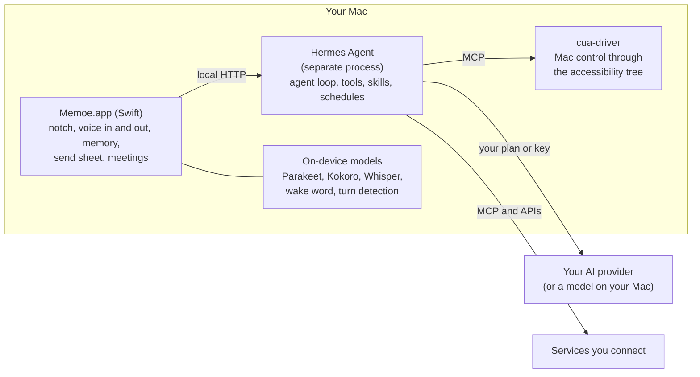

<p align="center">
  <a href="https://memoe.app">
    <picture>
      <source media="(prefers-color-scheme: dark)" srcset="brand/memoe-lockup-on-dark.svg">
      <source media="(prefers-color-scheme: light)" srcset="brand/memoe-lockup.svg">
      
    </picture>
  </a>
</p>

<h3 align="center">No chat box. Talk from any app, and it talks back.</h3>

<p align="center">
  Memoe (said <em>MEM-oh</em>, like memo) is a voice assistant that lives in your Mac's notch.<br>
  Already pay for Claude or ChatGPT? Then Memoe is free.
</p>

<p align="center">
  <a href="LICENSE"></a>
  <a href="#download"></a>
  <a href="https://memoe.app/download"></a>
  <a href="https://github.com/memoe-app/memoe/discussions"></a>
</p>

<p align="center">
  <a href="https://memoe.app/download"><b>Download</b></a> ·
  <a href="https://docs.memoe.app">Docs</a> ·
  <a href="#build-from-source">Build from source</a> ·
  <a href="https://github.com/memoe-app/memoe/discussions">Discussions</a> ·
  <a href="CONTRIBUTING.md">Contributing</a>
</p>

<!-- VIDEO: owner uploads mp4 via GitHub editor
     1. On github.com, edit README.md, drag the mp4 (under 10 MB on a free plan) into the editor.
     2. GitHub inserts a line like  https://github.com/user-attachments/assets/<id>
     3. Leave that URL alone on its own line, with a blank line above and below, right here.
        It renders as GitHub's own player: controls, muted, no autoplay, no loop, no poster.
        Do not wrap it in a link, a <p>, a <video> tag or a table cell. Export H.264 mp4.
     4. Copy the same line back into .oss/overlay/README.md, or the next export overwrites it.
     Keep the still below: it is what shows before the video is added, and the fallback
     anywhere the player does not load. -->

<p align="center">
  <a href="https://memoe.app">
    
  </a>
  <br>
  <sub>A frame from the launch film. You asked from Safari; Moe answered under the notch, out loud.</sub>
</p>

## Download

**[Download Memoe for Mac](https://memoe.app/download)**: a Mac with Apple silicon and macOS 15 or later.

It is a large download, a little over a gigabyte, because the speech and voice
models and the part of Moe that thinks are all inside it. Drag Memoe onto
Applications and open it. Memoe is signed and notarized, so macOS asks once
whether to open an app from the internet: click **Open**.

Moe thinks with an account you already have: a Claude or ChatGPT plan, an API
key from any model provider, or a model running on your own Mac (Ollama, LM
Studio or another local server). There is no Memoe model and no bill for
thinking. See [Bring your own brain](#bring-your-own-brain).

Prefer to build it yourself? Jump to [Build from source](#build-from-source).

## What it does

- **Lives in the notch, not a window.** Hold right ⌥ in whatever app you
  are in (or double-tap it, or say "Hey Moe") and talk. Moe answers out loud
  and on a small panel under the notch, and you can interrupt it at any time.
  A Mac without a notch gets a small black tab in the menu bar instead.
- **Does the work on your Mac.** It opens apps, uses their menus, fills in
  fields and uses its own browser for the web. It tries the app's data and
  scripting first and clicks only as a last resort, in the background, so your
  cursor does not move.
- **Remembers you.** A short list of plain facts about you that Moe reads
  before every answer. You can read every line, correct it or delete it, on the
  Memory page.
- **Asks before anything goes out.** Before an email, a message, an
  invitation or a shared file goes to another person, a sheet shows where it
  is going, to whom, and the whole text, which you can edit. Nothing is sent
  until you press **Send**.
- **Takes the meeting notes.** It records both sides of a call, transcribes
  it and separates the speakers on your Mac, then writes the notes. No bot
  joins the call, and recording never starts without you.
- **Reaches your services.** Mail, Calendar, Contacts, Notes and Reminders
  on this Mac, plus Gmail, Slack, Notion, GitHub and many more through
  [Composio](https://composio.dev) or any MCP server you add.

Every screen and every switch is documented at **[docs.memoe.app](https://docs.memoe.app)**,
built from [`doc.md`](doc.md) in this repository.

## Bring your own brain

Moe has no model of its own. It thinks with an account you already have:

- a Claude or ChatGPT plan, signed in through your browser;
- an API key from any model provider;
- or a model running on your own Mac (Ollama or another local server).

Pick one in **Settings › Brain** and change it whenever you like. We put no
model of our own behind it and never bill you for thinking.

## How it works



- **Memoe.app** is a native Swift app with no Dock icon. It listens, speaks,
  shows the panel under the notch, keeps your memory, and gates anything that
  goes out.
- **[Hermes Agent](https://github.com/NousResearch/hermes-agent)** by Nous
  Research (MIT) runs the thinking loop. Memoe installs a pinned commit of
  [a fork](https://github.com/Izzy-Gottz/hermes-agent) with Memoe's changes;
  the pin is in [`scripts/install-hermes.sh`](scripts/install-hermes.sh).
- **[cua-driver](https://github.com/trycua/cua)** (MIT) drives the Mac through
  the accessibility tree.
- **Speech** runs on [FluidAudio](https://github.com/FluidInference/FluidAudio)
  and [WhisperKit](https://github.com/argmaxinc/argmax-oss-swift) on Core ML.

## Privacy: what leaves your Mac

Speech recognition, the voice, meeting transcription and Moe's memory run on
your Mac. Your data lives in `~/Library/Application Support/Moe`.

**The official download.** In the words of the [docs](https://docs.memoe.app/privacy):

> On the free plan very little reaches us, and this is all of it. What you say
> to Moe, and what Moe reads to answer you, goes to the AI provider you chose
> to think with (your Claude or ChatGPT plan, or the company whose key you gave
> it), or stays on this Mac if you use a model running here. Services you
> connect through Composio go through Composio, and on the way they pass
> through our server, which holds the Composio key, counts each request
> against your plan's limits, and does not store what the requests say. Three
> things send something to us, and each one asks you first: signing in with
> Google, which sends only who you are; starting Away, which moves Moe into
> your own cloud computer; and problem reports, which send what you asked us
> to look at. Two more happen on their own, and there is no switch for them:
> once a day Moe asks our website whether there is a newer version, a plain
> request that says which version of Memoe is asking; and at most twice, ever,
> it sends our server a single word to count a person coming back, once if a
> third spoken command gets a real answer in your first week and once the
> first time one does on or after day 7. That word is all it carries: no
> account, no device or Mac identifier, and never what was said. A Memoe you
> build yourself from the open-source code sends neither count and does not
> check for updates. The speech recognition, the voice, the transcription and
> the memory all run on your Mac. The full policy is at
> [memoe.app/privacy](https://memoe.app/privacy), and it lists every service
> that ever touches your data.

**A build from this repository** has no code for our cloud services:

| What | Where it goes | When |
|---|---|---|
| What you say to Moe, and what it reads to answer you | The AI provider you chose (your plan or key), or nowhere if you use a model on your Mac | Every request: this is the thinking, and it goes to the account you picked, not to us |
| Sign-ins to services you connect through Composio | Composio, under your own Composio account | Only for services you connect that way |
| What you ask Moe to send | The person or service you approved on the send sheet | Only after you press Send |

## What is open, and what is not

| | This repository | The official download |
|---|:---:|:---:|
| The Mac app and everything it runs on your Mac | ✓ | ✓ |
| Sign-in, the Composio proxy, problem reports | — | ✓ (closed) |
| *Away*, the optional paid cloud service | — | ✓ (closed) |
| Updates itself | — | ✓ |
| Signed and notarized by the maintainer | — | ✓ |
| Price | free | free; Away is a paid plan |

The closed parts are not in this repository, and a build from this repository
does not need them. The official download is built from this code plus those
closed parts.

## Build from source

You need a Mac with Apple silicon, macOS 15 or later, and the Xcode Command
Line Tools (`xcode-select --install`). There is no Xcode project.

```sh
git clone https://github.com/memoe-app/memoe
cd memoe
./scripts/bootstrap.sh            # builds the community edition and opens it
./scripts/bootstrap.sh --models   # the same, with the speech and voice models bundled (~900 MB)
```

A build from this repository is the **community edition**, named **Memoe OSS**:
its own bundle identifier (`app.memoe.oss`), its own data folder
(`~/Library/Application Support/Memoe OSS`), no updater and no cloud. It can
never take the place of an official Memoe installed on the same Mac. Without
`--models`, each model downloads the first time it is needed. On first launch
the app installs Hermes from the pinned commit of the fork.

Tests: `MOE_SKIP_PG=1 ./scripts/test.sh` runs the Swift tests.

<details>
<summary><b>Build inputs that are not in git</b></summary>
<br>

| Path | What | How you get it | Required? |
|---|---|---|---|
| `Models/` | Core ML speech and voice models | `./scripts/bootstrap.sh --models`, or `scripts/fetch-models.sh` (from Hugging Face) | No: without them each model downloads when first needed |
| `hermes-seed/` | Hermes, prebuilt so the app thinks offline on first run | `scripts/stage-hermes-seed.sh` | No: without it the app installs Hermes on first run |
| `Resources/google-client.json` | A Google OAuth client of your own | Google Cloud Console | No |
| `Resources/telegram-client.json` | Telegram app credentials of your own | `scripts/stage-telegram-client.sh` | No |

</details>

### Composio in a build from source

Composio is optional. Without it, everything on your Mac and any MCP server
you add still works.

The official app reaches Composio through Memoe's own server, which holds the
Composio key, so the Mac never does. A build from this repository has no such
server. It talks to Composio directly, with a key from **your own** Composio
account ([platform.composio.dev](https://platform.composio.dev)). Put it in the
Keychain item the app reads, then quit and reopen the app:

```sh
security add-generic-password -s moe-composio-scoped -a api-key -w   # paste your ak_… key when asked
```

The app copies it into Hermes's `.env` (where Hermes's MCP client reads it) and
starts a Composio session with it. Connections and their sign-ins then live in
your Composio project, and Composio's usage limits and pricing are between you
and Composio.

A build from source is signed with your own identity (or ad hoc), uses a
different identity from the official app, and does not update itself.

## FAQ

<details>
<summary><b>Do I have to pay for anything?</b></summary>
<br>
No. The app is free, and Moe thinks with an account you already have. The only
paid thing is <i>Away</i>, an optional cloud plan, which is not in this repository.
</details>

<details>
<summary><b>Can it run entirely on my Mac?</b></summary>
<br>
Speech recognition, the voice, meeting transcription and memory always do.
Point Settings › Brain at a model on your own Mac (Ollama, LM Studio or another
local server) and the thinking does too.
</details>

<details>
<summary><b>My Mac has no notch.</b></summary>
<br>
Moe gets a small black tab in the middle of the menu bar instead.
</details>

<details>
<summary><b>Intel Mac?</b></summary>
<br>
Not supported: Memoe needs Apple silicon and macOS 15 or later.
</details>

## Contributing

Bug reports, fixes and ideas are welcome. Please read
[CONTRIBUTING.md](CONTRIBUTING.md) first. In short: open an issue for a bug you
can reproduce, discuss larger changes before writing them (in
[Discussions](https://github.com/memoe-app/memoe/discussions) or an issue), keep
pull requests small, and sign off your commits (`git commit -s`): this project
uses the [Developer Certificate of Origin](https://developercertificate.org).

Found a security problem? Please do not open an issue; see [SECURITY.md](SECURITY.md).

## Credits

Memoe did not build the hard parts, and says so.

- [Hermes Agent](https://github.com/NousResearch/hermes-agent) by Nous Research: the thinking loop (MIT)
- [cua-driver](https://github.com/trycua/cua) by Cua: Mac control (MIT)
- [FluidAudio](https://github.com/FluidInference/FluidAudio) by FluidInference: speech recognition and synthesis (Apache-2.0)
- [WhisperKit](https://github.com/argmaxinc/argmax-oss-swift) by Argmax: Whisper on Core ML (MIT)
- [Sparkle](https://github.com/sparkle-project/Sparkle): updates (MIT)
- [ONNX Runtime](https://github.com/microsoft/onnxruntime): wake word and turn detection (MIT)
- [OpenWhispr](https://github.com/OpenWhispr/OpenWhispr): dictation cleanup prompts, adapted (MIT)
- Models: NVIDIA Parakeet TDT 0.6B v3 and TDT-CTC 110M (CC-BY-4.0), Parakeet Realtime EOU 120M (NVIDIA Open Model License), OpenAI Whisper large-v3-turbo (MIT), hexgrad Kokoro-82M (Apache-2.0)

The complete list, with every licence and attribution, is in [NOTICE](NOTICE)
and in the app under Settings › About & Licences.

## License and trademark

Memoe is licensed under the [Apache License 2.0](LICENSE). Third-party
components keep their own licences; see [NOTICE](NOTICE) and
[LICENSES.md](LICENSES.md). Model weights are under their own licences and are
not part of this repository.

"Memoe", "Moe" as the name of this assistant, and the Memoe logo and icon are
trademarks of Yisrael Gottlieb. The licence covers the code, not the names or
the logo. If you distribute a modified build, give it a different name, icon
and bundle identifier. See [TRADEMARK.md](TRADEMARK.md).

The service icons in `Resources/ServiceIcons/` are trademarks of their owners,
used only to label those services in the app, and are not covered by this
repository's licence.

---

<p align="center">
  <a href="https://memoe.app">memoe.app</a> ·
  <a href="https://docs.memoe.app">docs</a> ·
  <a href="mailto:hello@moebot.app">hello@moebot.app</a>
</p>
