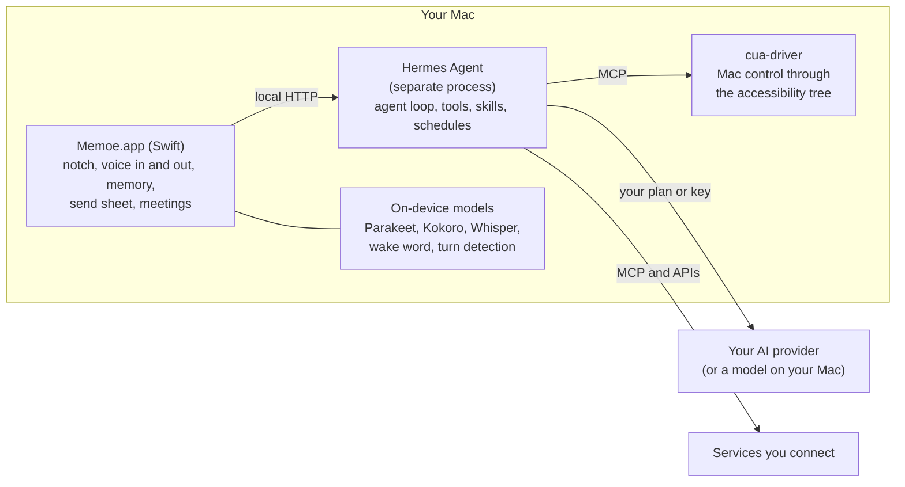

<p align="center">
  <a href="https://memoe.app">
    <picture>
      <source media="(prefers-color-scheme: dark)" srcset="brand/memoe-lockup-on-dark.svg">
      <source media="(prefers-color-scheme: light)" srcset="brand/memoe-lockup.svg">
      
    </picture>
  </a>
</p>

<p align="center">
  <strong>No chat box. Talk to Moe from any app on your Mac, and it talks back.</strong><br>
  Already pay for Claude or ChatGPT? Then Memoe is free.
</p>

<p align="center">
  <a href="https://memoe.app/download">Download</a> ·
  <a href="https://docs.memoe.app">Docs</a> ·
  <a href="CONTRIBUTING.md">Contributing</a> ·
  <a href="SECURITY.md">Security</a>
</p>

Memoe (said "MEM-oh", like *memo*) is a Mac app, and Moe is the assistant
inside it. Hold a key in whatever app you are in, say what you need, and Moe
answers out loud and does the work. There is no window to switch to first.

This repository is the Mac app: the notch, the voice, the memory, the send
sheet, meetings, connections, and the code that runs the thinking on your
Mac. It is free and open source under the Apache License 2.0.

## What it does

- **Talk from any app.** Hold right ⌥ (or double-tap it, or say "Hey Moe")
  and talk. Moe answers out loud and on a small panel under the notch. You
  can interrupt it at any time.
- **It remembers you.** Moe keeps a short list of plain facts about you and
  reads it before every answer. You can read every line, correct it, or
  delete it, on the Memory page.
- **It does the work on your Mac.** Moe opens apps, uses their menus, fills
  in fields and uses its own browser for the web. It tries the app's data
  and scripting first and clicks only as a last resort, in the background,
  so your cursor does not move.
- **It asks before anything goes out.** Before an email, a message, an
  invitation or a shared file goes to another person, a sheet shows you
  where it is going, to whom, and the whole text, which you can edit.
  Nothing is sent until you press Send.
- **Meetings.** It records both sides of a call on your Mac, transcribes
  and separates the speakers on your Mac, and writes the notes. No bot
  joins the call, and recording never starts without you.
- **Your services.** Mail, Calendar, Contacts, Notes and Reminders on this
  Mac, plus Gmail, Slack, Notion, GitHub and many more through
  [Composio](https://composio.dev) or any MCP server you add. A build from
  this repository uses Composio only with a Composio key of your own; see
  [Composio in a build from source](#composio-in-a-build-from-source).

The full feature documentation is at **[docs.memoe.app](https://docs.memoe.app)**,
built from [`doc.md`](doc.md) in this repository.

## Bring your own brain

Moe has no model of its own. It thinks with an account you already have:

- a Claude or ChatGPT plan, signed in through your browser;
- an API key from any model provider;
- or a model running on your own Mac (Ollama or another local server).

Pick one in Settings › Brain and change it whenever you like. We put no
model of our own behind it and never bill you for thinking.

## Privacy: what leaves your Mac

Speech recognition, the voice, meeting transcription and Moe's memory run
on your Mac. Your data lives in `~/Library/Application Support/Moe`.

| What | Where it goes | When |
|---|---|---|
| What you say to Moe, and what it reads to answer you | The AI provider you chose (your plan or key), or nowhere if you use a model on your Mac | Every request: this is the thinking, and it goes to the account you picked, not to us |
| Sign-ins to services you connect through Composio | Composio, which holds them for you, under your own Composio account in a build from this repository | Only for services you connect that way |
| What you ask Moe to send | The person or service you approved on the send sheet | Only after you press Send |

The app in this repository has no code for our cloud services.

## What is open, and what is not

**Open (this repository):** the Mac app and everything it runs on your Mac.

**Not open:** *Away*, an optional paid cloud service, and the parts of the
official app that talk to our servers (sign-in, the Composio proxy, problem
reports). That code is not in this repository, and a build from this
repository does not need it.

The official download is built from this code plus those closed parts, and
is signed by the maintainer.

## How it fits together



- **Memoe.app** is a native Swift app with no Dock icon. It listens,
  speaks, shows the panel under the notch, keeps your memory, and gates
  anything that goes out.
- **[Hermes Agent](https://github.com/NousResearch/hermes-agent)** by Nous
  Research (MIT) runs the thinking loop. Memoe installs a pinned commit of
  [a fork](https://github.com/Izzy-Gottz/hermes-agent) with Memoe's
  changes; the pin is in [`scripts/install-hermes.sh`](scripts/install-hermes.sh).
- **[cua-driver](https://github.com/trycua/cua)** (MIT) drives the Mac
  through the accessibility tree.
- **Speech** runs on [FluidAudio](https://github.com/FluidInference/FluidAudio)
  and [WhisperKit](https://github.com/argmaxinc/argmax-oss-swift) on Core ML.

## Build from source

You need a Mac with Apple silicon, macOS 15 or later, and the Xcode Command
Line Tools (`xcode-select --install`). There is no Xcode project.

```sh
git clone https://github.com/memoe-app/memoe
cd memoe
./scripts/bootstrap.sh            # builds the community edition and opens it
./scripts/bootstrap.sh --models   # the same, with the speech and voice models bundled (~900 MB)
```

A build from this repository is the **community edition**, named **Memoe OSS**: its own bundle
identifier (`app.memoe.oss`), its own data folder
(`~/Library/Application Support/Memoe OSS`), no updater and no cloud.
It can never take the place of an official Memoe installed on the same Mac.
Without `--models`, each model downloads the first time it is needed. On
first launch the app installs Hermes from the pinned commit of the fork.

Some build inputs are not in git:

| Path | What | How you get it | Required? |
|---|---|---|---|
| `Models/` | Core ML speech and voice models | `./scripts/bootstrap.sh --models`, or `scripts/fetch-models.sh` (from Hugging Face) | No: without them each model downloads when first needed |
| `hermes-seed/` | Hermes, prebuilt so the app thinks offline on first run | `scripts/stage-hermes-seed.sh` | No: without it the app installs Hermes on first run |
| `Resources/google-client.json` | A Google OAuth client of your own | Google Cloud Console | No |
| `Resources/telegram-client.json` | Telegram app credentials of your own | `scripts/stage-telegram-client.sh` | No |

Tests: `MOE_SKIP_PG=1 ./scripts/test.sh` runs the Swift tests.

### Composio in a build from source

Composio is optional. Without it, everything on your Mac and any MCP server
you add still works.

The official app reaches Composio through Memoe's own server, which holds
the Composio key, so the Mac never does. A build from this repository has no
such server. It talks to Composio directly, with a key from **your own**
Composio account ([platform.composio.dev](https://platform.composio.dev)).
Put it in the Keychain item the app reads, then quit and reopen the app:

```sh
security add-generic-password -s moe-composio-scoped -a api-key -w   # paste your ak_… key when asked
```

The app copies it into Hermes's `.env` (where Hermes's MCP client reads it)
and starts a Composio session with it. Connections and their sign-ins then
live in your Composio project, and Composio's usage limits and pricing are
between you and Composio.

A build from source is signed with your own identity (or ad hoc), uses a
different identity from the official app, and does not update itself.

## Contributing

Bug reports, fixes and ideas are welcome. Please read
[CONTRIBUTING.md](CONTRIBUTING.md) first. In short: open an issue for a bug
you can reproduce, discuss larger changes before writing them, keep pull
requests small, and sign off your commits (`git commit -s`).

Found a security problem? Please do not open an issue; see
[SECURITY.md](SECURITY.md).

## License

Memoe is licensed under the [Apache License 2.0](LICENSE). Third-party
components keep their own licences; see [NOTICE](NOTICE) and
[LICENSES.md](LICENSES.md). Model weights are under their own licences and
are not part of this repository.

## Trademark

"Memoe", "Moe" as the name of this assistant, and the Memoe logo and icon
are trademarks of Yisrael Gottlieb. The licence covers the code, not the
names or the logo. If you distribute a modified build, give it a different
name, icon and bundle identifier. See [TRADEMARK.md](TRADEMARK.md).

The service icons in `Resources/ServiceIcons/` are trademarks of their
owners, used only to label those services in the app, and are not covered by
this repository's licence.

## Credits

Memoe did not build the hard parts, and says so.

- [Hermes Agent](https://github.com/NousResearch/hermes-agent) by Nous Research: the thinking loop (MIT)
- [cua-driver](https://github.com/trycua/cua) by Cua: Mac control (MIT)
- [FluidAudio](https://github.com/FluidInference/FluidAudio) by FluidInference: speech recognition and synthesis (Apache-2.0)
- [WhisperKit](https://github.com/argmaxinc/argmax-oss-swift) by Argmax: Whisper on Core ML (MIT)
- [Sparkle](https://github.com/sparkle-project/Sparkle): updates (MIT)
- [ONNX Runtime](https://github.com/microsoft/onnxruntime): wake word and turn detection (MIT)
- [OpenWhispr](https://github.com/OpenWhispr/OpenWhispr): dictation cleanup prompts, adapted (MIT)
- Models: NVIDIA Parakeet TDT 0.6B v3 and TDT-CTC 110M (CC-BY-4.0), Parakeet Realtime EOU 120M (NVIDIA Open Model License), OpenAI Whisper large-v3-turbo (MIT), hexgrad Kokoro-82M (Apache-2.0)

The complete list, with every licence and attribution, is in
[NOTICE](NOTICE) and in the app under Settings › About & Licences.

Contact: hello@moebot.app
